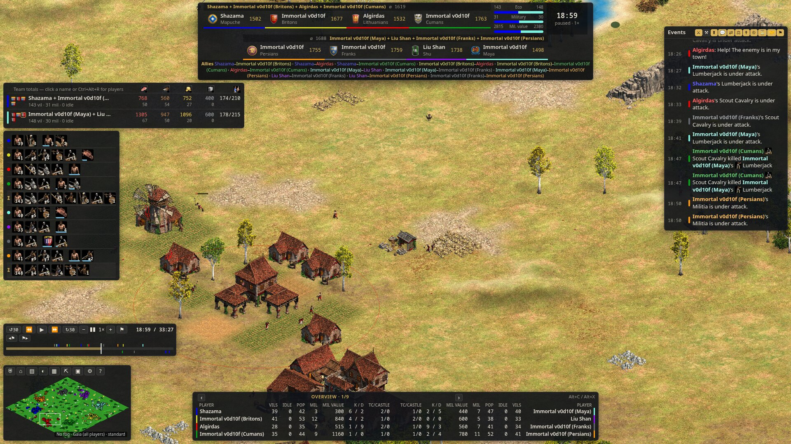

# Vantage

A spectator and replay viewer for **Age of Empires II: Definitive Edition** that runs in your browser.

Vantage reads the game's built-in spectator stream, rebuilds the full state of the match and draws it with your own copy of the game's graphics. You get a casting HUD, statistics and time controls on top. It can watch a game live, play a `.aoe2record` replay through the game, or play back a `.vrec` recording without the game running.



> Vantage is an independent project. It is not affiliated with or endorsed by Microsoft, World's Edge, Forgotten Empires or CaptureAge. See [Disclaimer](#disclaimer).

## Features

- **Scoreboard and team overview.** Shows each player's civilisation, Elo, score with its breakdown, population and housed time, and progress to the next age. Two-team games get balance bars, and there are status panels for regicide, King of the Hill, wonders and relics.
- **Dashboards.** Paged stat tables (economy, workers, stockpiles, APM, military, trade). Each layout (1v1, team games, FFA) has its own pages, and you can edit which columns each page shows.
- **Techs and production.** Panels for static and live research, production queues and unit composition. Hover a player's civ emblem to see that civ's tech tree.
- **Unit panel.** Shows stats, attack and armour bonuses, kills, damage dealt and taken, and activity over the last minute and over the unit's life. Select a group to see combined stats per unit type. Click a resource to see how much is left and who is gathering it.
- **World view and minimap.** Draws the game's own sprites, terrain, elevation, particles, fire and damage with WebGL. Fog modes (off, spy, standard), combined team fog, and any player's perspective. The minimap has standard, military and resource modes.
- **Time controls.** Seek anywhere, play at ×0.5 to ×8 or in reverse, skip 30 seconds, and set bookmarks. Replays the game plays for Vantage run at its fastest speed and buffer ahead, so you can watch them smoothly at 4–8×.
- **Statistics.** Charts for score, military, economy, technology, society and APM, plus aggregate tables and an end-of-game screen. Export as JSON or CSV.
- **Event log.** Kills, age-ups, chat, tribute, market, conversions, diplomacy, king and wonder alerts, and victory countdowns. You can filter by category, and clicking an event jumps to where and when it happened.
- **Casting tools.** Name players and teams, add flags or pictures, main and secondary text, series score and tournament stage. Panels can be moved, and the interface can be hidden for a clean feed. `/?overlay=1` gives a transparent HUD-only page to use as an OBS browser source.
- **Autocast.** An automatic camera director that follows the biggest fights and replays the story of each "hero" unit.
- **17 interface languages, skins and hotkeys.** Every hotkey can be rebound. Skins can be built in or your own (a folder or `.zip` of CSS and images). Settings profiles can be saved, exported and imported.
- **Recordings.** Live sessions can be saved as `.vrec` files. A recording plays back without the game running, so you can share it with anyone who has Vantage.
- **Return of Rome.** Return of Rome games are supported, with that mode's own names, icons and graphics.

## Requirements

- **Age of Empires II: Definitive Edition** installed through Steam. Vantage reads graphics, names, icons and sounds from your installation. It only has to be running for live games and replays. Without an install, Vantage can still play recordings, but with plain graphics and no sound.
- **Python 3.12 or newer**, and [uv](https://docs.astral.sh/uv/) or [pipx](https://pipx.pypa.io/) to install Vantage. Both need `git` to install from GitHub.
- A modern browser with WebGL2. Chromium-based browsers and Firefox both work.
- Optional: [`vgmstream-cli`](https://vgmstream.org/) for game sounds. Without it Vantage is silent. If `ffmpeg` is also installed, sounds are re-encoded to a smaller format.
- **Operating system.** Linux with the game running under Steam Proton is the tested platform. Native Windows support is new: the test suite passes on Windows, but it has not yet been used with the game on a Windows PC. Reports are very welcome.
- **For live games and replays only:** the client certificate files for the game's spectator API. See [Certificates](#certificates).

## Install

```sh
uv tool install git+https://github.com/dkapellusch/vantage-aoe2
# or
pipx install git+https://github.com/dkapellusch/vantage-aoe2
```

The package is called `aoe2-vantage` and installs a `vantage` command. To upgrade, run `uv tool upgrade aoe2-vantage` or `pipx upgrade aoe2-vantage`.

## Quick start

```sh
vantage doctor              # check what Vantage can find on this machine
vantage serve --open        # start Vantage and open it in your browser
```

From the home screen (<kbd>Ctrl+O</kbd>) you can open a recording, ask the game to play a replay, or connect to a live game. You can also start from the command line:

```sh
vantage serve --open game.vrec   # play a recording; the game does not need to be running
vantage serve --open --live      # watch whatever the running game is showing
vantage info game.vrec           # print a summary of a recording
```

Press <kbd>?</kbd> in the browser for the quick reference and <kbd>Esc</kbd> for the menu.

## Certificates

The game serves its spectator API on `127.0.0.1:4341` over mutual TLS and only accepts clients that present a certificate it trusts. **Vantage does not ship that certificate and cannot provide it.** For live games and replays, put these three files in Vantage's certificate folder:

```
certificate-authority.pem
cade-client.pem
cade-client.key
```

The folder is `$VANTAGE_CERTS` if that is set. Otherwise it is `~/.config/vantage/certs` on Linux or `%APPDATA%\Vantage\certs` on Windows. Never commit these files or share them.

You can still open `.vrec` recordings without the certificates.

## Documentation

| Page | What it covers |
|---|---|
| [Installation](docs/wiki/Installation.md) | Installing on Linux and Windows, upgrading, uninstalling |
| [Quick start](docs/wiki/Quick-start.md) | First run, the three kinds of source |
| [Live games](docs/wiki/Live-games.md) | Certificates, connecting, the in-game Spectate button, link handlers |
| [Replays](docs/wiki/Replays.md) | The replay browser, how replays are played, fast replay |
| [Recordings](docs/wiki/Recordings.md) | `.vrec` files: making, playing and sharing them |
| [Interface tour](docs/wiki/Interface-tour.md) | Every panel on screen |
| [Time controls](docs/wiki/Time-controls.md) | Seeking, speeds, reverse, bookmarks |
| [Hotkeys](docs/wiki/Hotkeys.md) | Every default key and how to rebind it |
| [Settings](docs/wiki/Settings.md) | Every setting and its default |
| [Casting and OBS](docs/wiki/Casting-and-OBS.md) | Names, series, overlays, the OBS browser source |
| [Command line](docs/wiki/Command-line.md) | Every command and flag |
| [Troubleshooting](docs/wiki/Troubleshooting.md) | When something does not connect or show up |
| [FAQ](docs/wiki/FAQ.md) | Common questions |
| [Translations](docs/wiki/Translations.md) | How the interface is translated |
| [Architecture](docs/architecture.md) | Components, data flow, keyframes, the HTTP API |
| [Wire format](docs/wire-format.md) | The game's spectator stream and how it is decoded |
| [Development](docs/development.md) | Setting up, testing, releasing |

The user guide lives in [docs/wiki/](docs/wiki/Home.md) and is the source of the [project wiki](https://github.com/dkapellusch/vantage-aoe2/wiki).

## Privacy

Vantage runs entirely on your computer. It has no accounts and no telemetry, and it never contacts a server of its own. Its only connections are to the game on `127.0.0.1` and from your browser to Vantage. The exception is a custom image URL you enter for casting, which your browser loads.

## Contributing

Bug reports, translations and pull requests are welcome. See [docs/development.md](docs/development.md) to get set up, run the tests and lint. Two rules:

- Never commit game files (graphics, sounds, strings) or the API certificates. Vantage reads game data from the user's installation at run time.
- Do not copy code or assets from other software unless its licence allows it.

## Licence

[MIT](LICENSE) © Dan Kapellusch.

## Disclaimer

Vantage is an independent, unofficial project. It is not affiliated with, endorsed by or sponsored by Microsoft, Xbox Game Studios, World's Edge, Forgotten Empires or CaptureAge. Age of Empires is a trademark of Microsoft Corporation.

Vantage ships no game assets. It reads graphics, sounds and strings at run time from your own installation of the game. It was made under Microsoft's [Game Content Usage Rules](https://www.xbox.com/en-US/developers/rules) using assets from Age of Empires II: Definitive Edition, and it is not endorsed by or affiliated with Microsoft.

Third-party runtime libraries and their licenses are listed in [THIRD_PARTY.md](THIRD_PARTY.md).
