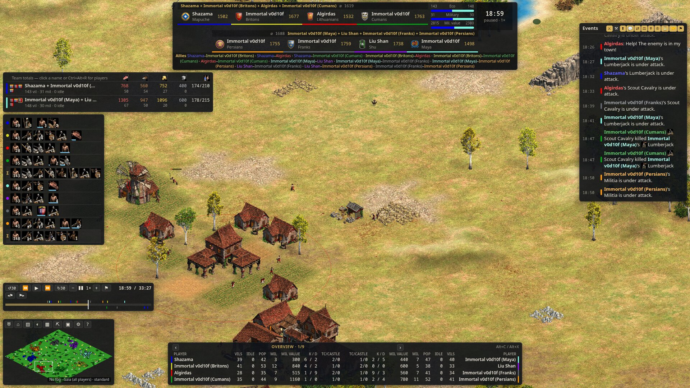

# Interface tour

Vantage's screen is the map with HUD panels around it. Every panel can be hidden or collapsed. The default keys are listed here, and all of them can be rebound (see [Hotkeys](Hotkeys.md)).

## Layout at a glance

The default **Caster** layout:

| Where | Panel |
|---|---|
| Top | Scoreboard, across the full width |
| Top left | Techs, production and composition |
| Bottom left | Team overview |
| Bottom centre | Dashboard |
| Top right | Event log |
| Bottom right | Minimap with the time controls above it, the selection (unit) panel beside it |

**Classic** (Panels menu → Layout) is the earlier arrangement: the team overview top left and the minimap bottom left.

## Moving and resizing panels

Hover a panel and drag the ⠿ button in its toolbar to move it, or drag one of its corners to resize it. Panels snap to the window edges and to the edges of other panels, or 6 px beside them; hold <kbd>Shift</kbd> while dragging to place a panel freely. <kbd>Esc</kbd> during a drag puts the panel back. With the ⠿ button focused, the arrow keys move a panel 10 px at a time (1 px with <kbd>Shift</kbd>).

**Arrange panels** (<kbd>Alt+L</kbd>, or Panels menu → **Arrange**) outlines every panel so you can drag any of them by its body; <kbd>Esc</kbd> or **Done** ends it. Double-click a panel's ⠿ button to put it back in its place, or use **Reset layout** in the Panels menu for every panel.

## Panels menu

The ▣ button by the minimap (or <kbd>Alt+V</kbd>, or <kbd>Esc</kbd> → **Panels**) lists every HUD panel. From there you can show, hide or collapse each one, and there are two presets:

- **Clean**: scoreboard, selection, time controls and minimap.
- **Everything**: every panel, none collapsed.

Each panel also has a small toolbar that appears when you hover it: ⠿ moves the panel, one button collapses it to its top strip, the other hides it. When you hide a panel, Vantage tells you how to bring it back.

## Scoreboard and team overview

The **scoreboard** shows team and player names, the score, and the series score when a series is set up (see [Casting and OBS](Casting-and-OBS.md)). Hover the score for its parts: military, economy, technology and society.

In team games and 1v1s, each side shows its team name and team score (Settings → Interface → *Team score*: total, average or off), with its players beneath as chips: civilisation emblem, name and score. Under the clock, a bar shows each side's share of the score, and the lead says by how much the leader is ahead. Team names are shortened: copies of one AI are named once with a count ("v0d10f ×2"), words both teams share are dropped ("Immortal v0d10f" vs "Immortal v0d9" reads "v0d10f" vs "v0d9"), and a team of different players shows two names and a count. Players who share a name with a teammate are labelled by civilisation. Hover a name for the full one. Alliances are listed only when they cross the lobby teams.

In team games and 1v1s the **team overview** (<kbd>Alt+Shift+R</kbd>) is a team board with two views, switched in its header or with <kbd>Ctrl+Alt+R</kbd>:

- **Teams**: one row per stat, comparing the two sides. Each side has its value and a bar, and the difference between them is in the leader's colour. Rows cover age, villagers, military, army value, idle villagers, resources banked with their workers, the **collection rate** (resources collected per minute over the last game minute), **resources collected** over the whole game, population, kills and losses. Fewer idle villagers and fewer losses count as ahead. Click a section heading to fold it.
- **Players**: a table with a row per player, grouped by team with a Σ total row. The best value in each column is marked, and five or more idle villagers is red. Under each player is the progress to the next age.

In free-for-all games the team overview has a row per player:

- the civilisation emblem. Hover it to see that civilisation's **tech tree**, with what the player has researched.
- the player name. Click it to cycle the player's colour.
- Elo, if known.
- resources banked and workers on each resource.
- population and cap. The population flashes while the player is housed.
- the current age and progress to the next one: food and gold against the age's cost, plus the two buildings it needs. Click the age icon to jump to the player's town centre.

**Flip sides** (<kbd>Alt+S</kbd>) swaps the left and right teams and is remembered for each game.

Special victory conditions get their own status: kings in regicide, the monument in King of the Hill, and wonder and relic countdowns. In free-for-all games, players who are out are marked.

The layout adapts to the game: 1v1 and team games (up to 4v4), free-for-all, Battle Royale, and Return of Rome. Settings → Interface → *Alternative FFA layout* switches FFA games to a more compact scoreboard.

## Techs

- **Static techs** (<kbd>Alt+T</kbd>): a grid of key technologies per player, showing researched, researching or not yet. *Full static techs* in the settings shows every tech line.
- **Live research**: technologies being researched, with progress. Finished ones stay for a few seconds. Click one to select the building researching it.
- **Slide-outs**: every technology (<kbd>Alt+P</kbd>) and a graph (<kbd>Ctrl+Alt+P</kbd>) slide out over the map.

## Production and composition

**Production & composition** (<kbd>Alt+Shift+P</kbd>) shows, per player, what each building is producing and the army and economy units they have by type. Click a unit icon to select those units. Click a production dot to jump to that building.

## Dashboard

The **dashboard** at the bottom is a table with a row per player. It has several pages, which you cycle with <kbd>Alt+C</kbd> and <kbd>Alt+X</kbd> or the arrows on the panel. Which pages you get depends on the game:

| Layout | Pages |
|---|---|
| 1v1 | overview, APM, economy activity, economy info, stockpiles, military, trade |
| Team games | Overview (including eco losses and total collected), economy info, stockpiles, APM, worker efficiency (overall and broken down), military, trade |
| Free-for-all | overview, overview with eco losses, economy info, stockpiles, APM, worker efficiency (overall and broken down), military |
| Battle Royale | top 4, top 8, stockpiles, military, APM |
| Return of Rome | default, economy efficiency, APM |

Team **Overview** has one page: villagers, idle workers, population, military,
army value, kills/deaths, economy kills, economy losses, TC idle/housed time,
town centres/castles, then **Collected** (total resources collected). The
existing columns keep their order. The former small Overview page is removed;
<kbd>Alt+C</kbd>/<kbd>Alt+X</kbd> and the tabs cycle the remaining team pages.
1v1 and FFA pages keep their existing columns and page sets. Saved selections of
the removed team page open the surviving Overview. The team title uses the
existing translated **Overview** key in every language; FFA still uses its
**Overview & eco losses** label.

Team Overview uses a single player list, grouped by team, so all eleven columns
fit the caster panel. Population/cap, kills/deaths and town centres/castles stack
their two values in the same column. **Coll.** means total resources collected;
hover the heading for its full name. Narrow panels show labelled player cards
with the same metrics in the same order; scroll vertically for more players.

**Idle TC (growth)** is elapsed time with at least one completed town centre
neither training nor researching. Each TC enters the window at completion. The
window closes permanently when its owner first reaches **120 living villagers**
or the **match population limit**, whichever comes first; later villager losses
do not reopen it. If neither is reached, it runs through the viewed time (or the
end of the match). The server option `--tc-idle-villagers N` changes the villager
target. The hub accepts the same option for both analysis and embedded viewers.
Hover, focus or tap a player's value for the definition, exact cutoff and the
**whole-game window** total. All dashboard pages, T90 pages, player review and
history charts use the same growth window.

A queued unit waiting for housing or the population limit is not idle;
**Housed** remains separate and covers the whole game. Queue handoffs under one
second count as work. Longer empty pauses count in full, including their first
second. The work/idle classification also drives each building's lifetime
activity bar; foundations are under construction rather than idle. Several idle
TCs do not multiply the player total: two idle TCs for one minute mean one minute
of Idle TC (growth).

The selected building's **Idle** in **Life / 60s / Fight** uses that same queue
definition, independently of the player's growth cutoff. Life shows the entire
observed lifetime; 60s and Fight show only their interval. Its tooltip explains
the distinction. **Working**, **Housed** and **Population limit** durations are
shown separately beneath the combat row. Foundations are excluded from idle, and
a destroyed building cannot contribute outside its observed lifetime.

The columns cover stockpiles, workers per resource, idle workers and idle town-centre time, housed time, worker efficiency, unit counts, army value and peak, kills and deaths, value destroyed, relics and relic gold, trade, tribute, market, conversions, resources collected, and APM (total and effective, split into economy and military). In **Settings → Dashboard pages** you can add, remove, reorder and edit the pages for 1v1, team games and FFA. *Mini dashboard* gives a compact version.

## Event log

The **event log** on the right lists what happens: kills and losses, units trained and techs researched, age-ups, chat (including chat sent while the game is paused), tribute, market trades, conversions, diplomacy changes, player status (resigned, dropped, waiting), king alerts, wonders and relics, and victory countdowns.

- The category icons along the top filter it. *Train and research* is hidden by default.
- "Under attack" alerts are folded to one per player per half minute; alerts about kings and other high-priority ones always show.
- Important events (a king threatened or killed, treason, wonders, relics, a near King of the Hill victory) get a highlighted area of their own.
- Click an event's icon or row to move the camera there. Click its time to jump there in time too.
- <kbd>PageUp</kbd> and <kbd>PageDown</kbd> scroll the log. <kbd>Shift+PageUp</kbd> and <kbd>Shift+PageDown</kbd> jump to the oldest or newest events.

## Selection panel

Selecting works like in the game:

- click to select a unit.
- drag to select everything in a box.
- double-click to select all units of that type on screen.
- <kbd>Shift</kbd> adds to the selection, and <kbd>Ctrl</kbd> toggles units in or out.

A selection can mix players.

- **One unit**: hit points, attack, armour and range (with bonuses against armour classes), reload, accuracy, speed, charge attacks, auras and regeneration, what it is carrying or doing, its garrison, and a monk's faith. A monk's **Lifetime healing** card shows HP restored and its estimated replacement value per resource (food, gold, and any other recorded costs). This uses the healed unit's owner-specific cost and maximum HP; it is not food or gold added to the stockpile. The card always covers its life up to the current replay time, independently of the Life/60s/Fight combat filter. You also see its kills (total, economy, friendly fire), conversions, damage dealt and taken, and how it spent its time over the last minute and over its life.
- **A group**: combined health and resource value, what the group is doing, one row per unit type with the owner's upgraded stats, and the group's kills, deaths, damage and conversions. Selecting several monks sums their lifetime healing, without counting shared healing twice.
- **A resource** (mine, bush, fish, tree or carcass): how much is left and who is gathering it.

Click a unit's name in the panel to give it a name of your own, such as a hero's nickname. Dead units stay in the selection with a skull (*Keep dead units in selection*). With nothing selected, the panel can show map information (*Show map info when nothing is selected*).

**Control groups**: <kbd>Ctrl+0</kbd>–<kbd>Ctrl+9</kbd> set a group, and <kbd>0</kbd>–<kbd>9</kbd> recall it. **Go-to keys** cycle through a player's buildings of one type (for example <kbd>Ctrl+B</kbd> for the next barracks), and <kbd>Ctrl+Shift</kbd> plus the same key selects all of them. <kbd>.</kbd> and <kbd>,</kbd> find idle villagers and idle military.

## The map

- **Camera.** Right-drag or middle-drag pans, and the wheel zooms at the cursor. The arrow keys and the screen edges scroll too (edge scrolling is a setting). <kbd>Alt+1</kbd>/<kbd>2</kbd>/<kbd>3</kbd> jump to zoom presets, and <kbd>Alt+Shift+1</kbd>/<kbd>2</kbd>/<kbd>3</kbd> save the current zoom into a preset. <kbd>Space</kbd> centres on the selection, <kbd>F</kbd> follows it, and <kbd>Ctrl+F</kbd> stops following.
- **Fog of war.** The ◐ button, or <kbd>Alt+F</kbd>, cycles **Off** (everything visible), **Spy** (all units drawn, terrain shaded by what the player has explored) and **Standard** (only what the player can see). <kbd>Alt+Shift+F</kbd> turns fog on and off. <kbd>Alt+D</kbd>, or a middle-click on the button, combines a whole team's vision.
- **Perspective.** <kbd>Ctrl+Shift+F1</kbd>–<kbd>F8</kbd> watch through player 1–8's eyes, and <kbd>Ctrl+Shift+F9</kbd> switches to Gaia (the whole map). <kbd>Ctrl+Space</kbd>, or <kbd>Shift</kbd>+right-click on a unit, takes the perspective of its owner. Hold <kbd>Tab</kbd> to peek at the selection owner's fog.
- **Colours.** <kbd>Ctrl+Alt+G</kbd> switches between game colours and team colours. <kbd>Ctrl+Alt+C</kbd> cycles colour schemes: game colours, cold vs warm, warm vs cold.
- **Range circles** (<kbd>Alt+Q</kbd>) for buildings and selected units.
- **Graphics.** The game's own sprites, terrain and elevation, fire and damage, particles, projectiles and the map's colour grade. These are drawn with WebGL. See [Settings](Settings.md#graphics).

## Minimap

The minimap shows terrain, players' units and buildings, and the camera's view. Click or drag on it to move the camera. <kbd>Alt+M</kbd> (or the button beside it) cycles **standard**, **military** and **resource** modes.

The buttons beside the minimap are: the menu (a shield), home (replays and recordings), statistics, the fog mode, the minimap mode, resources left, panels, settings and the quick reference. A button is highlighted while its mode is on.

## Resources left

**Resources left** (<kbd>Alt+R</kbd>) is a strip totalling the natural resources still on the map, including relics.

## Time controls

The bar above the minimap is covered in [Time controls](Time-controls.md).

## Statistics

**Statistics** (<kbd>Ctrl+Alt+S</kbd>) has tabs for **Score, Military, Economy, Technology, Society** and **APM**.

- Statistics opens on the whole game for every player. **Investigate** (under the chart) compares two players over an interval and narrows the chart to it; clicking a value on the dashboard opens Statistics already investigating that player.
- **Charts**: line or stacked, shown as actual values, % of the current total, or relative to the maximum. They can be overlaid with age-ups and economy or military techs. The wheel zooms a chart, and a right-click jumps the game to that moment.
- **Tables**: kills and losses, buildings razed and lost, conversions, relics, trade, tribute, market, research, age-up times, peak villagers and army, and more.
- **Time controls** on this screen show every value as it was at the chosen moment.
- **Save options** keeps a tab's chart choices. **Export stats** downloads the statistics as JSON and the time series as CSV.

## End of the game

When a game ends, in a recording or live, the **end-game screen** shows the winner, the placings, and each player's performance: floating resources, effective APM, worker efficiency and their most-created units. Click a moment to jump back to it. It can close itself after a while (*Close the end-of-game screen* in the settings).

## Autocast

**Autocast** (<kbd>Alt+A</kbd>) is an automatic camera director. It moves to the biggest fights and announces **heroes**, which are units with several kills. <kbd>Alt+Shift+A</kbd> (or **Show all**) lists every hero. Click a hero to replay its story: its birth, every kill (kills less than 10 seconds apart form a killing spree) and its death. The camera follows each moment and slows down as it comes. **Previous**, **Current** and **Next** step between moments, and ■ goes back to where you were. With *Autocast highlights* on, a fallen hero's story replays automatically.

## Sound

Vantage plays the game's own sounds as playback passes them: notifications, unit and combat sounds, taunts, villagers at work, animals and the ambience. You can set the volumes and which players' events make a sound in [Settings](Settings.md#sound). Sound needs `vgmstream-cli` (see [Installation](Installation.md#optional-game-sounds)).

## Getting help in the app

- <kbd>?</kbd>: the quick reference, with every key and mouse action under your current bindings.
- <kbd>Shift+F1</kbd>: the built-in documentation.
- <kbd>F1</kbd>: the tutorial. A short Return of Rome tutorial also appears the first time you watch a Return of Rome game.
- <kbd>F10</kbd>: the frame rate and the real versus target playback speed.
- <kbd>Ctrl+Alt+Shift+P</kbd>: a performance view (frame times, data fetches, memory).

Settings → Help and the quick reference show Vantage's version, with links to GitHub, this wiki and the issue tracker.

## Opening a match

The first frame stays behind a quiet loading cover while map textures, visible
sprites, HUD data, icons and fonts are prepared. The recording clock waits at
the first frame during this step. The laid-out HUD and finished map then fade
in together; reduced-motion preferences skip the fade and spinner animation.
A failed or stalled initial load offers **Reload**, without exposing a partial
map. In the hub the viewer, result table and charts reveal together.

### Farms and Folwarks

Select a farm to see its owner's farm upgrades and their observed research
completion times. A checkmark means earned; “Not yet” means the recording has
not shown it completed. Upgrades already present at the start have no invented
research time. Chinese team farm food, Sicilian farm-upgrade effects and Teuton
reseeding costs use their actual recorded technology states. The owner's new
farm capacity includes the effects already applied by the game. Capacity at
construction and farm age appear only when completion was observed. Working
farmers are links to the observed workers.

**Food remaining is not recorded** by the current spectator stream. Its farm
resource field is a small gathering buffer, not the lifetime food store. The
panel therefore shows “Not recorded”, along with new-farm capacity and capacity
at construction. Existing farms can receive partial top-ups from upgrades;
neither their remaining food nor their current maximum can be recovered
exactly from those fields.

A Folwark's panel lists observed bonus food, triggered farms and each farm's
grant. **Poles Folwark bonus food** also appears under economy bonus income.
These instant grants are excluded from gathered-food totals and collection
rates. Overlapping ranges pay once; when the stream cannot identify which
Folwark paid, the shared amount is marked separately on the eligible buildings.
Partial recordings and gaps can only provide observed totals.

Relevant upgrade chips come from the installed game's effects on the selected
object's ID or class, plus its upgrade line. They are filtered by its owner's
civilisation. Line upgrades come first, then blacksmith attack and armour,
other upgrades, and that civ's relevant unique technologies. Chips retain their
researched, researching, available and later-age states. Research offered by a
building is shown in its full tree; it is not automatically an upgrade to that
building. Monastery resource-flag research is included for converters, and
Faith/Heresy for units whose game help recommends resistance to Monks.
